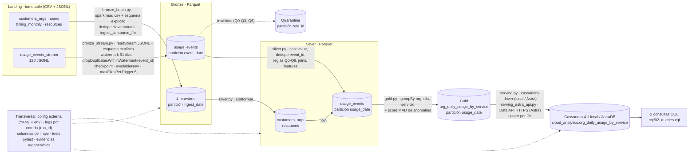

# Arquitectura v2 (implementada) · Patrón Lambda · 18/11/2026

Versión 2.0 de la arquitectura. Reemplaza al diagrama v1 de `docs/DISENO.md` (07/10/2026) y dibuja **solo lo que hoy corre** en el repositorio. Lo que todavía no está implementado figura en `docs/BACKLOG.md`, no en el diagrama.

## Cambios respecto de v1 (y por qué)

| v1 (07/10) | v2 (implementado) | Motivo |
|---|---|---|
| Streaming → `foreachBatch` → Silver/Gold incremental | Streaming hasta Bronze; Silver/Gold en batch desde Bronze | D13: menos complejidad, idempotencia por overwrite |
| `coalesce(1)` como regla | Parámetro `write.coalesce` (default 1 para la demo) | Feedback E1 y D10 |
| Watermark "10 minutes" en `settings.example.yaml` | `watermark: "61 days"` alineado con D9 + test que lo verifica | Feedback E1 |
| 5 marts y 5 tablas Cassandra | 1 mart (`org_daily_usage_by_service`) y 1 tabla, que es el alcance de E2 | Consigna 6.2; el resto está en el backlog |
| Solo AstraDB | AstraDB (keyspace `cloud_analytics`, poblado) + Cassandra local en Docker como alternativa | D17, D19 |
| Anomalías "a definir" | Score MAD en Gold (`cost_robust_z`, `is_cost_anomaly`) | D6, D15 |

## Correspondencia componente → código

| Componente | Código | Salida |
|---|---|---|
| Configuración | `config/settings.example.yaml`, `src/common/config.py` | defaults = decisiones cerradas |
| Esquemas explícitos | `src/common/schemas.py` | — |
| Batch a Bronze | `src/jobs/bronze_batch.py` | `datalake/bronze/{customers_orgs,users,billing_monthly,resources}` |
| Streaming a Bronze | `src/jobs/bronze_stream.py` | `datalake/bronze/usage_events`, `datalake/_checkpoints/bronze_usage_events` |
| Calidad y quarantine | `src/common/quality.py`, `src/jobs/silver.py` | `datalake/quarantine/usage_events` |
| Silver | `src/jobs/silver.py` | `datalake/silver/{usage_events,customers_orgs,resources}` |
| Gold + anomalías | `src/jobs/gold.py`, `src/common/anomaly.py` | `datalake/gold/org_daily_usage_by_service` |
| Serving | `src/jobs/serving.py` (driver), `src/jobs/serving_astra_api.py` (Data API), `cql/*.cql` | tabla en AstraDB y Cassandra local + consultas |
| Orquestación, logs, reset | `src/pipeline.py`, `src/common/logs.py` | `evidence/entrega2/logs/` |
| Experimentos | `src/experiments/` | `evidence/entrega2/{experimentos,idempotencia}.md` |

## Data Lake real (corrida con los 120 archivos)

Ver tabla completa en `evidence/entrega2/run_summary.md`. Puntos para la defensa:

- **Bronze eventos: 1 440 archivos** (24 micro-lotes × 60 fechas) de ~7,6 KB. Es el costo de particionar por fecha en streaming cuando cada archivo trae eventos de todo el rango. Sin `coalesce` eran 11 253 archivos (las 8 particiones del estado × fechas × lotes).
- **Silver y Gold: 60 archivos** (uno por día) gracias a `write.coalesce: 1`. En producción ese valor se sube o se deja en `null`.
- Promoción: Landing → Bronze (esquema válido + dedupe técnico) → Silver (reglas de calidad; inválidos a quarantine con motivo) → Gold (agregación con grano único verificado: 11 050 filas = 11 050 claves).

## Late data y watermark (cómo se comporta de verdad)

Experimento controlado en `evidence/entrega2/experimentos.md`: con 10 minutos se descartan los 200 eventos válidos de julio que llegan después de los de agosto; con 61 días se conservan y solo se descartan los eventos fuera del rango. Hallazgo para la defensa: en Spark 3.5 el filtro de late data usa el watermark calculado hasta el lote anterior, por lo que el primer lote después del arranque nunca descarta.
