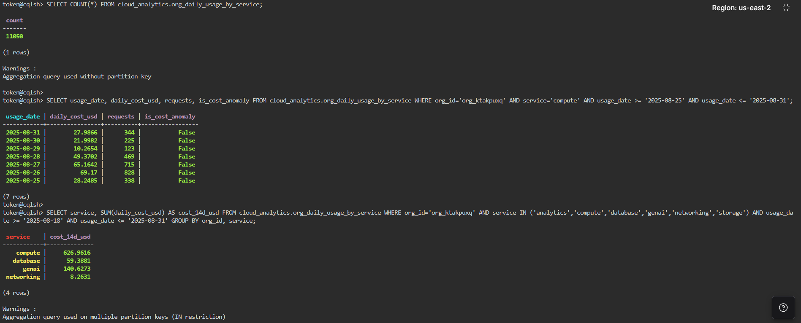

# AstraDB: carga de Gold y consultas

Base AstraDB serverless (AWS us-east-2), keyspace `cloud_analytics`, tabla `org_daily_usage_by_service` con `PRIMARY KEY ((org_id, service), usage_date)` y `usage_date DESC` (igual que `cql/01_schema.cql`). Generado por `python -m src.jobs.serving_astra_api` (Data API por HTTPS, D19).

- Filas antes de la carga: **11050** | cargadas: **11050** | después: **11050**

## Consulta 1: costos y requests diarios de `org_ktakpuxq` / `compute` entre 2025-08-25 y 2025-08-31

| usage_date | daily_cost_usd | requests | cpu_hours | storage_gb_hours | is_cost_anomaly |
|---|---|---|---|---|---|
| 2025-08-31 | 27.9866 | 344.0 | 5.3458 | 8.0952 | False |
| 2025-08-30 | 21.9982 | 225.0 | 3.5113 | 34.3998 | False |
| 2025-08-29 | 10.2654 | 123.0 | 2.6513 | 3.928 | False |
| 2025-08-28 | 49.3702 | 469.0 | 4.2299 | 72.4386 | False |
| 2025-08-27 | 65.1642 | 715.0 | 1.7885 | 7.3014 | False |
| 2025-08-26 | 69.17 | 828.0 | 1.8858 | 54.9735 | False |
| 2025-08-25 | 28.2485 | 338.0 | 4.835 | 22.3314 | False |

## Consulta 2: Top-N servicios por costo de `org_ktakpuxq`, últimos 14 días (2025-08-18 a 2025-08-31)

| service | cost_14d_usd | requests_14d |
|---|---|---|
| compute | 626.9616 | 6990.0 |
| genai | 140.6273 | 1115.0 |
| database | 59.3881 | 1180.0 |
| networking | 8.2631 | 733.0 |

## Captura del CQL console de AstraDB

Las mismas consultas en CQL (`cql/02_queries.cql`) ejecutadas en el CQL console de Astra: `COUNT(*)` = 11 050, 7 filas en la consulta 1 y 4 servicios en la consulta 2, idénticos a la Data API y a Cassandra local. La consulta 2 devuelve 4 servicios porque `org_ktakpuxq` solo tiene recursos de compute, genai, database y networking (sin analytics ni storage en `resources.csv`).

